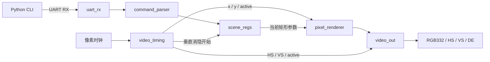

# xilinx-gpu

[](https://github.com/henshenry2026-lab/xilinx-gpu/actions/workflows/ci.yml)
[](LICENSE)

一个从小型 2D 图形核开始、逐步加入端侧模型计算的 FPGA 项目：**GPU 通过 UART 控制矩形；NPU 用 INT8 脉动阵列执行矩阵乘法**。

核心使用可综合 Verilog / SystemVerilog，面向 Xilinx 7 系列。GPU 支持一个实心矩形、黑色背景、RGB332、640×480 视频输出；新增 NPU 提供 **4×4 INT8 乘加阵列、INT32 输出、分银行 BRAM 和多块矩阵调度**。项目包含可重复运行的 Python 测试、RTL 仿真和综合检查。


上图来自集成测试第三帧的实际 RGB 输出：矩形位于 `(160, 120)`，尺寸 `320×240`，颜色 `0x1F`。检查脚本会比较仿真像素与这张图片。

## 快速运行

需要 Python **3.10+**、Icarus Verilog（`iverilog`、`vvp`）和 Yosys。参考模型、测试与图片生成只使用 Python 标准库。

```sh
git clone https://github.com/henshenry2026-lab/xilinx-gpu.git
cd xilinx-gpu
python tools/check.py
```

Ubuntu / Debian：

```sh
sudo apt-get update
sudo apt-get install -y iverilog yosys python3
python3 tools/check.py
```

Windows：在 **MSYS2 UCRT64 终端**安装工具，然后回到 PowerShell 执行检查：

```sh
pacman -S --needed mingw-w64-ucrt-x86_64-iverilog mingw-w64-ucrt-x86_64-yosys
```

```powershell
python tools/check.py
```

脚本会自动查找 PATH，以及常见的 `C:\msys64\ucrt64\bin` 和 `C:\msys64\mingw64\bin`；其他安装位置请把工具目录加入 PATH。检查失败会返回非零退出码，并保留完整日志。

生成内容位于被 Git 忽略的 `build/`：仿真日志、综合报告、综合后 JSON 网表、`demo.ppm`、`demo.png` 和 `check-summary.json`。有意修改演示场景后，使用 `python tools/check.py --update-preview` 刷新 README 图片。

## NPU 矩阵计算

`npu_top` 计算 `C[M,N] = A[M,K] × B[K,N]`，默认支持 `M,N≤16`、`K≤64`，可运行非方阵和不足 4×4 的尾块。输入是有符号 INT8，结果是未经缩放的 INT32；输出带行列标签并支持反压。A、B 各有 1 KiB 逻辑存储，空闲时装载，计算期间由 4×4 阵列复用。

```sh
python tools/npu_model.py    # 显示参考结果与固定步长写地址
python tools/check.py        # GPU + NPU 的统一检查入口
```

设计借鉴 hls4ml / FINN 的量化与并行复用、Google TPU 的脉动阵列，以及 Snowflake / Angel-Eye 的存算组织。详见 [NPU 架构、接口、验证和参考资料](docs/npu.md)。这是面向未来端侧小模型和 JEPA 研究的矩阵内核；板级传输和完整模型执行留待后续实现。

## GPU 模块与“存、算”



| 模块 | 职责 |
|---|---|
| `uart_rx` | 两级同步，8-N-1 中点采样，报告停止位错误 |
| `command_parser` | 包头、CRC、操作码、边界校验，接收超时恢复 |
| `scene_regs` | 当前与待提交两组参数，垂直消隐期间原子切换 |
| `video_timing` | 像素坐标、显示有效区、行场同步、提交脉冲 |
| `pixel_renderer` | 并行比较矩形边界，决定每个像素的颜色 |
| `video_out` | 把 RGB、DE、HS、VS 一起寄存，消隐区输出黑色 |
| `gpu_top` | 连接上述模块，供仿真和综合使用 |

**存储：**用触发器保存位置、宽高、颜色和待更新状态，v1 不需要帧缓冲。**计算：**对扫描坐标执行矩形覆盖判断，每个像素时钟输出一个颜色。矩形使用半开区间 `[x, x+width)`、`[y, y+height)`。

复位后画面全黑。收到有效命令只更新待提交参数；扫描到垂直消隐起点时整体提交，所以活动画面中不会混用两组参数。同一帧的多条有效命令采用最后一条。若新命令恰好与提交处于同一时钟，旧待提交参数先提交，新命令保留到下一次提交。

## PC 控制与 UART 协议

不连接硬件即可查看命令：

```sh
python tools/uart_rect.py --x 160 --y 120 --width 320 --height 240 --color 0x1f --dry-run
```

向板卡发送时才需要 `pyserial`：

```sh
python -m pip install -r requirements.txt
python tools/uart_rect.py --port COM3 --x 40 --y 30 --width 200 --height 120 --color 0xe0
# Linux 示例：--port /dev/ttyUSB0
```

串口默认 **115200 baud、8 数据位、无校验、1 停止位**。13 字节命令如下：

| 偏移 | 长度 | 字段 |
|---|---|---|
| 0 | 2 | 固定包头 `A5 5A` |
| 2 | 1 | 操作码 `01`：设置矩形 |
| 3 | 2 | x，无符号 16 位、小端 |
| 5 | 2 | y，无符号 16 位、小端 |
| 7 | 2 | width，无符号 16 位、小端 |
| 9 | 2 | height，无符号 16 位、小端 |
| 11 | 1 | RGB332：`RRRGGGBB` |
| 12 | 1 | CRC-8/SMBUS，覆盖偏移 2～11 |

CRC 多项式 `0x07`，初值 `0x00`，不反射，最终异或 `0x00`；标准校验向量 `123456789` 得到 `0xF4`。宽高须大于零，且整个矩形必须处于 640×480 内。硬件使用 17 位边界加法，避免 16 位溢出绕过检查。

坏 CRC、不支持的操作码、非法矩形会被丢弃，并保留当前画面。字节间超时 10 ms、UART 停止位错误或复位会清除未完成的命令。超时按 RTL 参数 `CLOCK_HZ` 计算。v1 单向接收，无 ACK；完整帧发送后，命令在下一次可用的垂直消隐提交。

## FPGA 接口与上板

`gpu_top` 的默认参数为 `CLOCK_HZ=25175000`、`BAUD=115200`。

| 端口 | 方向 | 含义 |
|---|---|---|
| `clk_pix` | 输入 | 25.175 MHz 像素时钟，使用 FPGA 专用时钟网络 |
| `rst` | 输入 | 与 `clk_pix` 同步的高有效复位，至少保持两个时钟 |
| `uart_rx_pin` | 输入 | 串口 RX，模块内部含两级同步 |
| `rgb[7:0]` | 输出 | RGB332，颜色与 DE、HS、VS 同拍对齐 |
| `de` | 输出 | 有效显示区标志 |
| `hsync` / `vsync` | 输出 | 低有效行/场同步 |

| 时序 | 有效区 | 前沿 | 同步脉宽 | 后沿 | 总计 |
|---|---:|---:|---:|---:|---:|
| 水平（像素） | 640 | 16 | 96 | 48 | 800 |
| 垂直（行） | 480 | 10 | 2 | 33 | 525 |

标称帧率为 `25,175,000 / (800 × 525) ≈ 59.9405 Hz`。输出级有一个像素周期的寄存延迟，RGB 和同步信号共同延迟。修改 `CLOCK_HZ` 只会改变 UART/超时的分频参数；实际视频速率由输入像素时钟决定。

上板时需要针对真实开发板完成以下接线：用 Clocking Wizard 产生像素时钟；把 PLL/MMCM 的稳定状态纳入同步复位；按原理图配置时钟、UART、视频引脚与 I/O 电平。VGA 需要板载 DAC 或合适的电阻网络；HDMI 还需要 TMDS 编码与串行发送模块，不能直接接这些 RGB 信号。

板卡型号、封装引脚和视频电路尚未确认，因此仓库目前提供可移植核心，没有宣称可直接下载的 bitstream 或已验证的 XDC。

## 验证状态

`python tools/check.py` 和 GitHub Actions 使用同一检查入口：

- Python：CRC 标准向量、字节序、合法边界、非法参数、无串口依赖的 dry-run。
- UART：连续字节、约 ±1.4% 位速率偏差、短毛刺、坏停止位、break 后恢复、中途复位。
- 命令解析：CRC/操作码错误、零尺寸、越界、加法溢出、包头噪声、超时和错误恢复。
- 场景：参数原子提交、后到覆盖、提交与新命令同拍、矩形四边及消隐。
- 集成：经真实串行比特流控制，逐像素检查连续 **3 帧、共 1,260,000 个扫描周期**；每帧 307,200 个活动像素、50,400 个 HS 低电平周期、1,600 个 VS 低电平周期。
- 综合：`synth_xilinx -family xc7`，随后执行 `check -assert`。
- NPU：5 项 Python 参考模型测试、PE/阵列自检查，以及 **29 组矩阵分别在 4×4、2×2 配置**下与整数参考结果比较；检查极值、尾块、反压、错误输入和复位恢复。
- NPU 综合：独立综合 `npu_top`，检查 DSP 与 BRAM 映射并运行 `check -assert`。

2026-11-10 本地验证使用 Icarus Verilog 13.0、Yosys 0.66 和 Python 3.13。GPU 映射约为 **261 个 LUT、398 个触发器、0 BRAM、0 DSP**；默认 4×4 NPU 映射到 **16 个 DSP48E1、8 个 RAMB18E1**。不同综合版本和布局结果可能变化。完整统计见本地 `build/synthesis.log`、`build/npu-synthesis.log` 或 CI 验证产物。

**尚未完成：**Vivado 布局布线/时序收敛、实际 FPGA 下载、显示器和串口的硬件验证。当前结果证明功能仿真和 7 系列逻辑综合通过。

## 项目结构

```text
rtl/                  GPU 的 6 个功能模块与 gpu_top
rtl/npu/              PE、脉动阵列、分银行缓存与 npu_top
tests/rtl/            4 个自检查 SystemVerilog 测试台
tests/npu/            NPU 的 PE、阵列、任务级测试台
tests/test_uart_rect.py
tests/test_npu_model.py
tools/uart_rect.py    UART 编码与发送 CLI
tools/npu_model.py    整数参考模型、写地址打包与测试向量
tools/check.py        GPU + NPU 跨平台验证与预览生成
docs/demo.png         从真实 RTL 输出生成的演示图
docs/npu.md           NPU 接口、存算组织与参考资料
.github/workflows/    同入口 CI
```

后续可加入 GPU 的多矩形/帧缓冲，并在 NPU 上逐步补齐量化线性层与数据搬运，验证 JEPA 编码器或预测器所需的算子。

## English overview

A small synthesizable GPU/NPU learning project for Xilinx 7-series FPGAs. The GPU draws one UART-controlled rectangle at 640×480 with atomic scene updates. The independent NPU computes signed INT8 matrix products using a 4×4 output-stationary systolic array, INT32 accumulators and banked BRAM. Default jobs support M/N up to 16 and K up to 64, with tagged results and backpressure.

Run `python tools/check.py` with Python 3.10+, Icarus Verilog and Yosys. It checks Python models, GPU benches and three video frames, NPU PE/array behavior, 29 GEMMs on both 4×4 and 2×2 configurations, and Xilinx synthesis of both cores. The README image comes from the simulated pixel stream. See [NPU documentation](docs/npu.md) for interfaces and references. Board integration, Vivado timing closure and trained JEPA execution remain future work.

## 许可证

[MIT](LICENSE)，Copyright © 2026 Slash。
