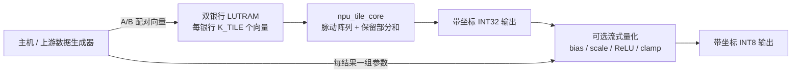
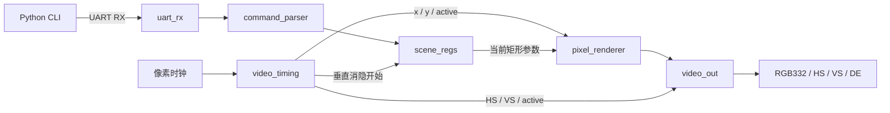

# xilinx-gpu

[](https://github.com/henshenry2026-lab/xilinx-gpu/actions/workflows/ci.yml)
[](LICENSE)

一个从小型 2D 图形核开始、逐步加入端侧模型计算的 FPGA 项目：**GPU 通过 UART 控制矩形；NPU 用 INT8 脉动阵列执行矩阵乘法**。

核心使用可综合 Verilog / SystemVerilog，面向 Xilinx 7 系列。GPU 支持一个实心矩形、黑色背景、RGB332、640×480 视频输出；NPU 提供 **INT8 脉动阵列、INT32 累加和量化线性层**。新增低存储流式路径在默认 4×4、K_TILE=16 时，仅保留 **320 字节 A/B/C 逻辑数据**，支持跨 K 块累加与装载/计算重叠。项目包含可重复运行的 Python 测试、RTL 仿真和综合检查。


上图来自集成测试第三帧的实际 RGB 输出：矩形位于 `(160, 120)`，尺寸 `320×240`，颜色 `0x1F`。检查脚本会比较仿真像素与这张图片。

## 快速运行

需要 Python **3.10+**、Icarus Verilog（`iverilog`、`vvp`）和 Yosys。参考模型、测试与图片生成只使用 Python 标准库。

```sh
git clone https://github.com/henshenry2026-lab/xilinx-gpu.git
cd xilinx-gpu
python tools/check.py
```

Ubuntu / Debian：

```sh
sudo apt-get update
sudo apt-get install -y iverilog yosys python3
python3 tools/check.py
```

Windows：在 **MSYS2 UCRT64 终端**安装工具，然后回到 PowerShell 执行检查：

```sh
pacman -S --needed mingw-w64-ucrt-x86_64-iverilog mingw-w64-ucrt-x86_64-yosys
```

```powershell
python tools/check.py
```

脚本会自动查找 PATH，以及常见的 `C:\msys64\ucrt64\bin` 和 `C:\msys64\mingw64\bin`；其他安装位置请把工具目录加入 PATH。检查失败会返回非零退出码，并保留完整日志。

生成内容位于被 Git 忽略的 `build/`：仿真日志、综合报告、综合后 JSON 网表、`demo.ppm`、`demo.png`、`check-summary.json`，以及新路径的 `npu-memory-summary.json`、`npu-cycle-summary.json` 和逐任务周期记录。CI 上传相同摘要和日志。有意修改演示场景后，使用 `python tools/check.py --update-preview` 刷新 README 图片。

## NPU 矩阵计算

`npu_top` 计算 `C[M,N] = A[M,K] × B[K,N]`，默认支持 `M,N≤16`、`K≤64`，可运行非方阵和不足 4×4 的尾块。输入是有符号 INT8，结果是 INT32；输出带行列标签并支持反压。`npu_linear_top` 在 GEMM 后增加逐通道 INT32 bias、ties-away 定点重定标、可选 ReLU 和 INT8 饱和。两种顶层都可以独立使用；缺参会拒绝启动，非法 scale 写入会报告错误。

```sh
python tools/npu_model.py    # 显示参考结果与固定步长写地址
python -m unittest tests/test_npu_model.py -v  # 检查定点参考模型
python tools/check.py        # GPU + NPU 的统一检查入口
```

设计借鉴 hls4ml / FINN 的量化与并行复用、Google TPU 的脉动阵列，以及 Snowflake / Angel-Eye 的存算组织。详见 [NPU 架构、接口、验证和参考资料](docs/npu.md)。这是面向未来端侧小模型和 JEPA 研究的矩阵内核；板级传输和完整模型执行留待后续实现。

## 低存储 Streaming Micro-NPU

`npu_stream_top` 和 `npu_stream_linear_top` 是独立的新接口，复用同一脉动阵列；原有 BRAM 顶层继续保留。新路径按块接收配对的 A/B 向量，两个缓存银行交替装载和消费，INT32 部分和留在 PE 中直到完整 K 维计算结束。矩阵尺寸为 16 位非零数，缓存容量随 `LANES`、`K_TILE` 改变，与完整矩阵尺寸无关。



默认 A 双缓冲 128 B、B 双缓冲 128 B、C 累加 64 B，共 **320 B**。这只是数据负载，不是全部硬件状态：还包括传播/错拍寄存器、控制、64 位统计计数器和量化输出寄存器。小缓存采用打包的分布式 RAM，避免多个小银行各占一个 BRAM；实际分配以综合报告为准。

主机按“块行、块列、k”重放操作数；量化参数按结果的块内输出顺序逐项提供，不保存整层参数表。输入传输和参数重放都计入 Python 流量模型。用小缓存换取数据重读的成本是显式的，并没有假设外部存储具有无限带宽。

```sh
python tools/npu_stream.py                 # 默认内存与 16→32→16 MLP 调度预算
python tools/npu_stream.py --lanes 2       # 比较小阵列
python tools/npu_stream.py --sweep         # LANES / K_TILE / 理论 Tile 数参数扫描
python tools/check.py                     # 整体功能、计数器对照与综合
```

仿真中的两层 MLP 由测试台调度，第二层使用第一层的实际 RTL 输出。当前只实现一个 Tile；扫描中的多 Tile 数据仅是理论估算。batch=1 的矩阵形状会闲置阵列行，因此报告有效 MAC/周期和利用率，不把 PE 峰值当作应用性能。新接口、流量公式、计数器含义见 [NPU 文档](docs/npu.md#低存储流式接口)。

## 单样本极低存储 GEMV

`npu_gemv_top` 和 `npu_gemv_linear_top` 为 **batch=1** 提供独立向量后端。每拍一个 INT8 激活广播到 `LANES` 个输出通道，配合一组权重并行乘加；输出组之间由外部重放输入。默认 4 路 INT32 累加负载为 **16 字节**，没有完整输入、权重或分块 RAM。这个数字只包含累加器，不代表整个核心：控制、计数器和量化输出寄存器另计。

```sh
python tools/npu_mapper.py --backend gemv --lanes 4 --model examples/npu/tiny_mlp.json --inputs examples/npu/tiny_mlp_input_single.json --output-dir build/mapped-gemv --simulate
python tools/check.py
```

输入维度必须为 `[1][K]`；GEMV 不使用 `--k-tile`。默认后端仍是 `gemm`，旧命令和导出格式保持兼容。两种后端采用相同的量化数值规则，逐层连接实际 RTL 激活；主机仍负责层调度和数据重放。

统一检查对 LANES=1/2/4 进行原始和量化 GEMV 仿真与综合，并用两种模型、连续输入和固定种子停顿，对比 GEMV 与 2×2/4×4 GEMM，共 20 组模型运行。结果见 `build/npu-gemv-summary.json` 与 CI 产物；周期不包含主机中转或实际传输，也未换算为工作频率或功耗。详见 [GEMV 接口与数据流](docs/npu.md#单样本-gemv-接口)。

2026-11-14 本地 Yosys 0.66 / Icarus 对同一未训练 `16→32→16`、batch=1 模型的结果（均含量化后处理）：

| 后端 | 总 DSP48E1 | A/B/C 或部分和负载（字节） | 连续供数忙碌周期 | 带停顿忙碌周期 | 操作数流量（字节） |
|---|---:|---:|---:|---:|---:|
| GEMM LANES=2 | 8 | 144 | 786 | 837 | 2048 |
| GEMM LANES=4 | 20 | 320 | 498 | 552 | 2048 |
| GEMV LANES=4 | 8 | 16 | 306 | 455 | 1280 |

GEMV4 原始/量化顶层分别使用 4/8 个 DSP、651/1524 个逻辑 LUT 原语、518/692 个触发器，均为零 BRAM/LUTRAM。量化后处理的 4 个 DSP 已计入表中总量；负载字节不含控制、统计等状态。相比 GEMM2，连续场景周期比约 2.57、停顿场景约 1.84；这是不同宽度逻辑流下的仿真比较，不是同一物理链路上的实测加速比。

## 量化模型到流式 NPU 的映射器 v0

`tools/npu_mapper.py` 将**串接的线性层 JSON**转换成现有 RTL 可消费的配对 A/B 向量和逐结果参数流：逐通道 INT8 权重、INT32 bias、正整数乘数/右移、可选 ReLU。激活 input/output scale 显式指定，权重 scale 可逐通道指定或按最大绝对值自动计算；所有零点固定为0。工具只依赖 Python 标准库，`--simulate` 才需要 Icarus Verilog。

```sh
python tools/npu_mapper.py --model examples/npu/tiny_mlp.json --inputs examples/npu/tiny_mlp_inputs.json --output-dir build/mapped --simulate
python tools/npu_mapper.py --model examples/npu/tiny_mlp.json --inputs examples/npu/tiny_mlp_inputs.json --output-dir build/mapped-l2 --lanes 2 --simulate
python tools/check.py
```

示例为固定随机种子的未训练 `16→32→16` MLP，附3条输入。权重布局为 **weights[K][N]**，输入为 `[batch][K]`。导出目录包含 `mapped-model.json`、任务描述符、首次量化输入、操作数/参数流、参考结果和 `report.json`。仿真直接读取这些流文件，使用捕获的 RTL 中间激活驱动下一层，并检查整数结果、坐标、last、反压和周期计数。

报告区分 **Python binary64 浮点参考与反量化整数结果的误差**、**RTL 与整数参考是否逐项一致**。它记录 MAE/RMSE/最大绝对误差、真正截断的元素数、仅命中 INT8 上下界的元素数、逐通道缩放近似误差、输入/权重重放、参数流量和逻辑激活存储预算。`rtl_validation.status` 只有在实际仿真和结果核对后才为 `passed`；不带 `--simulate` 时为 `not_run`。

2026-11-14 本地示例结果（K_TILE=16；周期为两层 busy 周期之和，含测试输入间断和输出反压，排除主机层间调度/传输）：

| Batch | LANES | 有效 MAC | A/B 流量 B | 参数紧密打包 B | 逻辑主机激活峰值 B | 仿真 busy 周期 |
|---:|---:|---:|---:|---:|---:|---:|
| 1 | 2 | 1024 | 2048 | 420 | 48 | 837 |
| 1 | 4 | 1024 | 2048 | 420 | 48 | 552 |
| 3 | 2 | 3072 | 4096 | 1260 | 144 | 1679 |
| 3 | 4 | 3072 | 2048 | 1260 | 144 | 709 |

batch=3 的最终输出 RMSE 约 **0.01715**、最大绝对误差约 **0.04554**，两层均无输出截断；这是该确定性示例的数值误差，不是模型任务精度。LANES=2/4 的整数结果相同。激活峰值仅指理论双区 INT8 负载，Python 验证工具还保留源模型、参考矩阵和各层跟踪，不能据此推断进程实际内存。

统一检查另测 `5→7→3` 尾块、batch=1/3、LANES=2/4 和 K_TILE=3；汇总见 `build/npu-mapper-summary.json`，逐配置证据见 `build/mapper/`，CI 同步上传。完整格式、算式和文件顺序见 [映射器接口说明](docs/npu.md#模型映射器-v0)。目前没有 ONNX/Keras/PyTorch 导入、自动激活标定、训练或真实 FPGA 模型执行。

## GPU 模块与“存、算”



| 模块 | 职责 |
|---|---|
| `uart_rx` | 两级同步，8-N-1 中点采样，报告停止位错误 |
| `command_parser` | 包头、CRC、操作码、边界校验，接收超时恢复 |
| `scene_regs` | 当前与待提交两组参数，垂直消隐期间原子切换 |
| `video_timing` | 像素坐标、显示有效区、行场同步、提交脉冲 |
| `pixel_renderer` | 并行比较矩形边界，决定每个像素的颜色 |
| `video_out` | 把 RGB、DE、HS、VS 一起寄存，消隐区输出黑色 |
| `gpu_top` | 连接上述模块，供仿真和综合使用 |

**存储：**用触发器保存位置、宽高、颜色和待更新状态，v1 不需要帧缓冲。**计算：**对扫描坐标执行矩形覆盖判断，每个像素时钟输出一个颜色。矩形使用半开区间 `[x, x+width)`、`[y, y+height)`。

复位后画面全黑。收到有效命令只更新待提交参数；扫描到垂直消隐起点时整体提交，所以活动画面中不会混用两组参数。同一帧的多条有效命令采用最后一条。若新命令恰好与提交处于同一时钟，旧待提交参数先提交，新命令保留到下一次提交。

## PC 控制与 UART 协议

不连接硬件即可查看命令：

```sh
python tools/uart_rect.py --x 160 --y 120 --width 320 --height 240 --color 0x1f --dry-run
```

向板卡发送时才需要 `pyserial`：

```sh
python -m pip install -r requirements.txt
python tools/uart_rect.py --port COM3 --x 40 --y 30 --width 200 --height 120 --color 0xe0
# Linux 示例：--port /dev/ttyUSB0
```

串口默认 **115200 baud、8 数据位、无校验、1 停止位**。13 字节命令如下：

| 偏移 | 长度 | 字段 |
|---|---|---|
| 0 | 2 | 固定包头 `A5 5A` |
| 2 | 1 | 操作码 `01`：设置矩形 |
| 3 | 2 | x，无符号 16 位、小端 |
| 5 | 2 | y，无符号 16 位、小端 |
| 7 | 2 | width，无符号 16 位、小端 |
| 9 | 2 | height，无符号 16 位、小端 |
| 11 | 1 | RGB332：`RRRGGGBB` |
| 12 | 1 | CRC-8/SMBUS，覆盖偏移 2～11 |

CRC 多项式 `0x07`，初值 `0x00`，不反射，最终异或 `0x00`；标准校验向量 `123456789` 得到 `0xF4`。宽高须大于零，且整个矩形必须处于 640×480 内。硬件使用 17 位边界加法，避免 16 位溢出绕过检查。

坏 CRC、不支持的操作码、非法矩形会被丢弃，并保留当前画面。字节间超时 10 ms、UART 停止位错误或复位会清除未完成的命令。超时按 RTL 参数 `CLOCK_HZ` 计算。v1 单向接收，无 ACK；完整帧发送后，命令在下一次可用的垂直消隐提交。

## FPGA 接口与上板

`gpu_top` 的默认参数为 `CLOCK_HZ=25175000`、`BAUD=115200`。

| 端口 | 方向 | 含义 |
|---|---|---|
| `clk_pix` | 输入 | 25.175 MHz 像素时钟，使用 FPGA 专用时钟网络 |
| `rst` | 输入 | 与 `clk_pix` 同步的高有效复位，至少保持两个时钟 |
| `uart_rx_pin` | 输入 | 串口 RX，模块内部含两级同步 |
| `rgb[7:0]` | 输出 | RGB332，颜色与 DE、HS、VS 同拍对齐 |
| `de` | 输出 | 有效显示区标志 |
| `hsync` / `vsync` | 输出 | 低有效行/场同步 |

| 时序 | 有效区 | 前沿 | 同步脉宽 | 后沿 | 总计 |
|---|---:|---:|---:|---:|---:|
| 水平（像素） | 640 | 16 | 96 | 48 | 800 |
| 垂直（行） | 480 | 10 | 2 | 33 | 525 |

标称帧率为 `25,175,000 / (800 × 525) ≈ 59.9405 Hz`。输出级有一个像素周期的寄存延迟，RGB 和同步信号共同延迟。修改 `CLOCK_HZ` 只会改变 UART/超时的分频参数；实际视频速率由输入像素时钟决定。

上板时需要针对真实开发板完成以下接线：用 Clocking Wizard 产生像素时钟；把 PLL/MMCM 的稳定状态纳入同步复位；按原理图配置时钟、UART、视频引脚与 I/O 电平。VGA 需要板载 DAC 或合适的电阻网络；HDMI 还需要 TMDS 编码与串行发送模块，不能直接接这些 RGB 信号。

板卡型号、封装引脚和视频电路尚未确认，因此仓库目前提供可移植核心，没有宣称可直接下载的 bitstream 或已验证的 XDC。

## 验证状态

`python tools/check.py` 和 GitHub Actions 使用同一检查入口：

- Python：CRC 标准向量、字节序、合法边界、非法参数、无串口依赖的 dry-run。
- UART：连续字节、约 ±1.4% 位速率偏差、短毛刺、坏停止位、break 后恢复、中途复位。
- 命令解析：CRC/操作码错误、零尺寸、越界、加法溢出、包头噪声、超时和错误恢复。
- 场景：参数原子提交、后到覆盖、提交与新命令同拍、矩形四边及消隐。
- 集成：经真实串行比特流控制，逐像素检查连续 **3 帧、共 1,260,000 个扫描周期**；每帧 307,200 个活动像素、50,400 个 HS 低电平周期、1,600 个 VS 低电平周期。
- 综合：`synth_xilinx -family xc7`，随后执行 `check -assert`。
- NPU：9 项 Python 参考模型测试和 PE/阵列自检查；GEMM 与量化线性层各有 **29 组矩阵分别在 4×4、2×2 配置**下与 Python 整数参考结果比较，量化层另含 7 组定向计算。检查极值、尾块、反压、bias、舍入、饱和、激活、错误输入和复位恢复。
- NPU 综合：独立综合 `npu_top` 和 `npu_linear_top`，检查 DSP 与 BRAM 映射并运行 `check -assert`。
- 流式 NPU：每配置 31 组矩阵（包含确定性舍入/饱和和两层 MLP），原始/量化路径均测试 4×4、2×2；另测 1×1/K_TILE=1 与 3×3/K_TILE=7。覆盖跨 K 块、输入间断、输出反压、非法参数重试、复位、完整 K/M/N=65535 边界和周期/流量模型对照。
- 流式综合：分别检查原始/量化、4×4/2×2 四种配置，要求 DSP、分布式 RAM 和零 BRAM 映射；运行 `check -assert`。
- 模型映射器：数值/格式/流布局测试、半整数邻近值和尺度溢出回归；6组模型配置直接消费导出流并串接实际 RTL 激活，逐项比较整数结果，核查周期，并检查损坏流会失败且不会保留通过状态。
- GEMV：原始/量化、LANES=1/2/4 共六配置，每配置 13 组定向/随机任务及非法命令、复位检查；另有 20 组映射模型对比与六组资源综合，要求数值一致、无操作数 RAM、DSP 随并行度线性增长，并检查默认配置的周期/DSP 预算。

2026-11-11 本地验证使用 Icarus Verilog 13.0、Yosys 0.66 和 Python 3.13。GPU 映射约为 **261 个 LUT、398 个触发器、0 BRAM、0 DSP**；默认 4×4 NPU GEMM 映射到 **16 个 DSP48E1、8 个 RAMB18E1**，带量化线性层的顶层映射到 **20 个 DSP48E1、8 个 RAMB18E1**。不同综合版本和布局结果可能变化。完整统计见本地 `build/` 或 CI 验证产物。

2026-11-12 使用相同本地工具检查新流式路径（K_TILE=16）：

| 顶层 | LANES | A/B/C 逻辑字节 | DSP48E1 | RAMB18/36 | RAM32M | 逻辑 LUT 原语 | 触发器 |
|---|---:|---:|---:|---:|---:|---:|---:|
| `npu_stream_top` | 4 | 320 | 16 | 0 | 12 | 1673 | 1284 |
| `npu_stream_linear_top` | 4 | 320 | 20 | 0 | 12 | 2573 | 1459 |
| `npu_stream_top` | 2 | 144 | 4 | 0 | 6 | 1294 | 978 |
| `npu_stream_linear_top` | 2 | 144 | 8 | 0 | 6 | 2144 | 1153 |

LUT 列不含 LUTRAM 占用；RAM32M 是原语数量，不能当作字节数。触发器包含控制和统计；量化层另有组合缩放逻辑。以上是独立顶层的逻辑综合结果，不包含 GPU，也没有测得工作频率、功耗或物理时延。

**尚未完成：**Vivado 布局布线/时序收敛、实际 FPGA 下载、显示器和串口的硬件验证。当前结果证明功能仿真和 7 系列逻辑综合通过。

## 项目结构

```text
rtl/                  GPU 的 6 个功能模块与 gpu_top
rtl/npu/              PE、脉动阵列、分银行缓存与 npu_top
                       npu_linear_top 的逐通道定点后处理
                       npu_stream_buffer / tile_core / stream_top / stream_linear_top
tests/rtl/            4 个自检查 SystemVerilog 测试台
tests/npu/            NPU 的 PE、阵列、任务和量化层测试台
tests/test_uart_rect.py
tests/test_npu_model.py
tools/uart_rect.py    UART 编码与发送 CLI
tools/npu_model.py    整数参考模型、写地址打包与测试向量
tools/npu_stream.py   低存储分块、向量重放、流量和周期预算、MLP 向量
tools/npu_mapper.py   线性层 JSON 量化、流导出、误差与存储/流量报告
tools/npu_mapper_sim.py  导出流的 RTL 仿真与结果/计数器核对
tools/hdl_tools.py    共享 Icarus / Yosys 查找
examples/npu/         未训练 16→32→16 示例模型与3条输入
tools/check.py        GPU + NPU 跨平台验证与预览生成
docs/demo.png         从真实 RTL 输出生成的演示图
docs/npu.md           NPU 接口、存算组织与参考资料
.github/workflows/    同入口 CI
```

后续可加入 GPU 的多矩形/帧缓冲；NPU 可从实测 batch=1 利用率和输入流量出发，优化矩阵向量数据流，再接真实存储接口、框架参数导入和其他算子，逐步验证 JEPA 编码器或预测器。

## English overview

A small synthesizable GPU/NPU learning project for Xilinx 7-series FPGAs. The GPU draws one UART-controlled rectangle at 640×480 with atomic scene updates. The independent NPU computes signed INT8 matrix products using a 4×4 output-stationary systolic array, INT32 accumulators and banked BRAM. Its linear wrapper adds per-channel bias, ties-away fixed-point scaling, optional ReLU and INT8 saturation.

The new streaming tops retain only a bounded tile working set: 320 bytes of logical A/B/C payload at LANES=4, K_TILE=16, with ping-pong LUTRAM, K-chunk accumulation and streamed quantization parameters. Control, pipelines and counters are reported separately. Tests chain a 16→32→16 INT8 MLP using actual RTL intermediate outputs; layer scheduling is host-side. One Tile is implemented; multi-Tile sweep figures are theoretical.

The Python mapper accepts sequential floating-point linear layers as JSON, applies zero-point-zero per-channel weight quantization and explicit activation scales, and exports the actual operand/parameter streams. The default `gemm` backend retains its existing format; `--backend gemv` selects a batch-one scalar-broadcast vector core with streamed weights and no operand RAM. At four lanes its INT32 accumulator payload is 16 bytes, excluding control, counters and the quantized output register. `--simulate` feeds exported streams into the selected RTL and chains captured intermediate activations. Reports separate binary64-reference quantization error from exact integer RTL agreement, and logical activation payload from actual host memory. Examples are deterministic and untrained; framework import, automatic calibration and trained-model execution are future work.

Run `python tools/check.py` with Python 3.10+, Icarus Verilog and Yosys. It checks Python models, GPU benches and three video frames, legacy GEMM/linear regressions, 31 streaming jobs per configuration, full 16-bit dimension edges, RTL/model cycle counters, and thirteen Xilinx synthesis configurations. GEMV checks add six raw/linear bench configurations and twenty mapped model comparisons with and without stalls. The README image comes from the simulated pixel stream. See [NPU documentation](docs/npu.md) for interfaces and references. Board integration, Vivado timing closure and trained JEPA execution remain future work.

## 许可证

[MIT](LICENSE)，Copyright © 2026 Slash。
