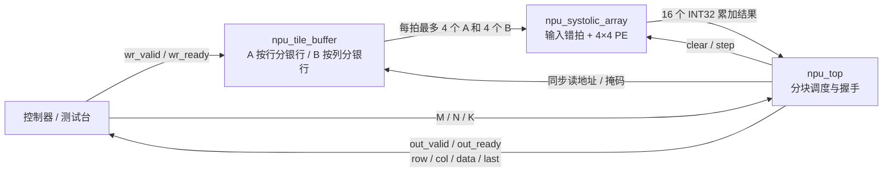

# INT8 矩阵计算核心

首个 NPU 里程碑实现 `C[M,N] = A[M,K] × B[K,N]`：默认 **4×4 脉动阵列、INT8 有符号输入、INT32 累加和输出**。核心可以直接由 SystemVerilog 测试台或同一时钟域的控制器驱动。现有 GPU 的矩形 UART 命令仍由 `gpu_top` 处理；NPU 使用独立的 `npu_top` 接口。

## 数据如何存、如何算



| 文件 | 职责 |
|---|---|
| `rtl/npu/npu_pe.v` | 一个有符号乘加器；A 向右、B 向下传递，累加结果留在本 PE |
| `rtl/npu/npu_systolic_array.sv` | 连接 PE 网格，按行列编号错拍输入，支持整体暂停和清零 |
| `rtl/npu/npu_tile_buffer.sv` | A、B 的同步读取分银行 BRAM，支持空闲期逐字节装载 |
| `rtl/npu/npu_top.sv` | 检查描述符、遍历输出块、等待波前排空、逐项输出带坐标的结果 |
| `tools/npu_model.py` | 无第三方依赖的整数参考计算、固定步长地址打包、可重复测试向量 |

默认 `LANES=4, MAX_M=16, MAX_N=16, MAX_K=64`。每个任务可以指定 `1≤M≤16, 1≤N≤16, 1≤K≤64`。A、B 各提供 1024 字节有效存储，输出矩阵按 4×4 块计算；不足 4 行或 4 列的尾块用有效掩码处理。当前一次任务的整个 K 维必须装入片上缓存。

每拍从 A 读取最多 4 行各一个数，从 B 读取最多 4 列各一个数。A 的第 r 行、B 的第 c 列分别延迟 r、c 拍进入阵列，使相同 k 的两个操作数在 PE(r,c) 相遇。每个 PE 每步最多执行一次 MAC。计算采用 output-stationary 数据流：乘加结果保留在 PE 内，块输出完成后再清零计算下一块。

顶层按 `IDLE → CLEAR → FEED → DRAIN → EMIT` 调度。BRAM 读取有一拍延迟，有效位与掩码同步延迟；读完 K 项后排空阵列，再冻结累加器输出。不同输出块顺序执行，输入装载、计算、输出尚未重叠。

## 输入存储布局

主机地址是所选缓存内的字节地址，使用**硬件最大尺寸的固定步长**：

```text
A[r,k] → wr_sel=0, wr_addr=r*MAX_K+k
B[k,c] → wr_sel=1, wr_addr=k*MAX_N+c
```

例如默认配置的 2×3 乘 3×2：A 第二行从地址 64 开始，B 第二行从地址 16 开始。Python 的 `pack_writes(a, b)` 返回 `(wr_sel, wr_addr, byte)` 列表，负数编码为 8 位补码。

内部 A 按 `r % LANES` 分银行，B 按 `c % LANES` 分银行；每个银行提供独立同步读端口。默认共 8 个银行。BRAM 内容不复位；启动任务前必须装载本次会读取的全部操作数。控制器可在空闲时复用已知有效的内容，RTL 不跟踪装载完整性。

## 顶层接口与完整调用周期

所有端口属于 `clk` 时钟域，`rst` 为同步高有效复位。握手在时钟上升沿发生，发送端应保持 valid 和负载直到 ready。

| 端口 | 方向 | 行为 |
|---|---|---|
| `wr_valid`, `wr_ready` | 输入 / 输出 | 空闲时逐字节写入；`wr_valid && wr_ready` 表示该次写请求已接收 |
| `wr_sel`, `wr_addr[15:0]`, `wr_data signed[7:0]` | 输入 | 选择 A/B、固定步长地址、INT8 操作数 |
| `cmd_valid`, `cmd_ready` | 输入 / 输出 | 接收任务描述符；与写入同拍时描述符优先，`wr_ready=0` |
| `cmd_m`, `cmd_n`, `cmd_k`，各 16 位 | 输入 | 运行时 M、N、K |
| `busy` | 输出 | 任务计算或输出期间为 1；此时不接收写入和描述符 |
| `error` | 输出 | 接收非法描述符或越界写地址后置 1 拍；该操作被拒绝 |
| `out_valid`, `out_ready` | 输出 / 输入 | 结果流握手；反压时 valid、坐标、数值和 last 保持 |
| `out_row[15:0]`, `out_col[15:0]`, `out_data signed[31:0]` | 输出 | 全局行列坐标与整数累加结果 |
| `out_last` | 输出 | 最后一个有效结果的标志，与该结果一起保持到握手 |
| `done` | 输出 | 所有块排空后置 1 拍；尾块可能先跳过填充位置，随后才产生 done |

调用顺序：复位 → 等待空闲 → 握手写入 A、B → 握手提交 M/N/K → 持续接收结果并按坐标放入 C → 等待 done → 提交下一任务。零尺寸、超出最大尺寸的描述符和越界写入均报告 error；忙碌时 ready 为 0 的请求没有被接收，不能当作已执行。

输出按“块行、块列、块内行、块内列”遍历，只发送真实坐标。例如 2×5 的默认配置先输出 `(0,0)…(0,3), (1,0)…(1,3)`，再输出 `(0,4), (1,4)`。接收方必须使用坐标重建矩阵。只要 `out_valid=0`，输出负载就没有含义。

复位会中止正在计算或等待接收的任务，并清除控制/累加状态。复位后应重新建立操作数内容的有效性，再启动任务。

## 数值约定与检查

输入为 `[-128,127]`，乘积完整保留 16 位，符号扩展后累加到 32 位。默认 K≤64 时最大绝对和不超过 `64×128×128=1,048,576`，不会溢出 INT32。本版输出原始整数和，不包含量化比例、零点、偏置、舍入、饱和或激活；后续模型量化需明确定义这些规则。

```sh
python tools/npu_model.py
python tools/check.py
```

第一条显示 2×3 乘 3×2 的输入、结果 `[[22,64],[7,-90]]` 和写地址；第二条运行 GPU 与 NPU 的全部检查。`build/npu_cases.txt` 是 Python 生成的确定性向量，完整日志和摘要见 `build/` 或 CI 产物。

NPU 自检查覆盖：

- PE：INT8 极值、正负乘积、64 项 INT32 累加、valid、暂停、清零和复位。
- 阵列：输入错拍、相邻传播、K=1/3/9、整体暂停后继续。
- 顶层：29 组参考矩阵分别在 4×4 与 2×2 阵列运行，包含最大尺寸、随机数、非方阵和尾块。
- 接口：输出反压与负载稳定、重复/遗漏坐标、最后项、忙碌时阻止输入、非法描述符、越界写入，以及计算和输出期间复位。

默认 4×4 配置经 Yosys 0.66 的 `synth_xilinx -family xc7` 映射到 **16 个 DSP48E1、8 个 RAMB18E1**，随后运行 `check -assert`。银行并行读取使物理 BRAM 分配大于 2 KiB 有效数据容量。这里只统计 `npu_top`；GPU 独立综合。2×2 配置验证功能，其他参数组合尚未纳入检查。

资源映射不代表 Vivado 布局布线、最高频率、功耗或上板结果。NPU 当前没有板级时钟/引脚约束、UART/AXI 适配器或 DDR 通路；验证范围是整数内核的仿真和逻辑综合。

## 设计参考与 JEPA 方向

本版代码独立实现，只借鉴以下设计思路，没有移植这些项目的源码，也没有引用其性能作为本项目指标：

| 参考 | 吸收的思路 | 本版对应实现 |
|---|---|---|
| [hls4ml 精度与 ReuseFactor](https://github.com/fastmachinelearning/hls4ml/blob/main/docs/api/configuration.rst) | 显式数值精度、并行度与复用的资源权衡 | 固定 INT8/INT32，LANES 控制空间并行，输出分块复用阵列 |
| [FINN folding constraints](https://github.com/Xilinx/finn/blob/main/docs/finn/reference/folding-constraints.rst) | PE/SIMD 并行与折叠调度、量化数据流 | 多个 PE 并行、K 维按拍复用；当前接口独立于 FINN 工具链 |
| [Google TPU 论文](https://doi.org/10.1145/3079856.3080246) | INT8 矩阵乘阵列、片上存储与确定性调度 | 小型脉动网格、显式缓存和状态机 |
| [Snowflake](https://doi.org/10.1109/ISCAS.2017.8050809) | 可扩展卷积加速器、数据复用 | 从复用的矩阵运算块起步，后续可接卷积展开或专用数据生成 |
| [Angel-Eye](https://doi.org/10.1109/TCAD.2017.2705069) | 低精度计算、存储/计算配合、软硬件映射 | 固定整数数据约定、Python 装载布局、可编程任务尺寸 |

[I-JEPA](https://github.com/facebookresearch/ijepa) 在表示空间做预测，后续可以先选定小型编码器或预测器的一层线性投影，将其权重量化为 INT8，导出 A/B，验证整数计算与反量化误差。之后再补偏置、requantization、激活、残差和模型所需的其他算子，以及超出片上容量时的 K 分块与数据搬运。

当前并未运行训练好的 JEPA 模型。整数计算逐位一致、量化后的表示质量、完整模型时延和真实 FPGA 行为需要分别验证。
