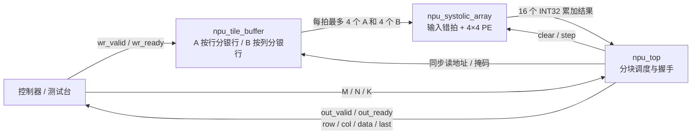

# INT8 矩阵计算核心

首个 NPU 里程碑实现 `C[M,N] = A[M,K] × B[K,N]`：默认 **4×4 脉动阵列、INT8 有符号输入、INT32 累加和输出**。核心可以直接由 SystemVerilog 测试台或同一时钟域的控制器驱动。现有 GPU 的矩形 UART 命令仍由 `gpu_top` 处理；NPU 使用独立的 `npu_top` 接口。

## 数据如何存、如何算



| 文件 | 职责 |
|---|---|
| `rtl/npu/npu_pe.v` | 一个有符号乘加器；A 向右、B 向下传递，累加结果留在本 PE |
| `rtl/npu/npu_systolic_array.sv` | 连接 PE 网格，按行列编号错拍输入，支持整体暂停和清零 |
| `rtl/npu/npu_tile_buffer.sv` | A、B 的同步读取分银行 BRAM，支持空闲期逐字节装载 |
| `rtl/npu/npu_top.sv` | 检查描述符、遍历输出块、等待波前排空、逐项输出带坐标的结果 |
| `rtl/npu/npu_linear_top.sv` | 在 GEMM 结果流上执行每通道偏置、定点缩放、ReLU 和 INT8 饱和 |
| `tools/npu_model.py` | 无第三方依赖的整数参考计算、固定步长地址打包、可重复测试向量 |

默认 `LANES=4, MAX_M=16, MAX_N=16, MAX_K=64`。每个任务可以指定 `1≤M≤16, 1≤N≤16, 1≤K≤64`。A、B 各提供 1024 字节有效存储，输出矩阵按 4×4 块计算；不足 4 行或 4 列的尾块用有效掩码处理。当前一次任务的整个 K 维必须装入片上缓存。

每拍从 A 读取最多 4 行各一个数，从 B 读取最多 4 列各一个数。A 的第 r 行、B 的第 c 列分别延迟 r、c 拍进入阵列，使相同 k 的两个操作数在 PE(r,c) 相遇。每个 PE 每步最多执行一次 MAC。计算采用 output-stationary 数据流：乘加结果保留在 PE 内，块输出完成后再清零计算下一块。

顶层按 `IDLE → CLEAR → FEED → DRAIN → EMIT` 调度。BRAM 读取有一拍延迟，有效位与掩码同步延迟；读完 K 项后排空阵列，再冻结累加器输出。不同输出块顺序执行，输入装载、计算、输出尚未重叠。

## 输入存储布局

主机地址是所选缓存内的字节地址，使用**硬件最大尺寸的固定步长**：

```text
A[r,k] → wr_sel=0, wr_addr=r*MAX_K+k
B[k,c] → wr_sel=1, wr_addr=k*MAX_N+c
```

例如默认配置的 2×3 乘 3×2：A 第二行从地址 64 开始，B 第二行从地址 16 开始。Python 的 `pack_writes(a, b)` 返回 `(wr_sel, wr_addr, byte)` 列表，负数编码为 8 位补码。

内部 A 按 `r % LANES` 分银行，B 按 `c % LANES` 分银行；每个银行提供独立同步读端口。默认共 8 个银行。BRAM 内容不复位；启动任务前必须装载本次会读取的全部操作数。控制器可在空闲时复用已知有效的内容，RTL 不跟踪装载完整性。

## 顶层接口与完整调用周期

所有端口属于 `clk` 时钟域，`rst` 为同步高有效复位。握手在时钟上升沿发生，发送端应保持 valid 和负载直到 ready。

| 端口 | 方向 | 行为 |
|---|---|---|
| `wr_valid`, `wr_ready` | 输入 / 输出 | 空闲时逐字节写入；`wr_valid && wr_ready` 表示该次写请求已接收 |
| `wr_sel`, `wr_addr[15:0]`, `wr_data signed[7:0]` | 输入 | 选择 A/B、固定步长地址、INT8 操作数 |
| `cmd_valid`, `cmd_ready` | 输入 / 输出 | 接收任务描述符；与写入同拍时描述符优先，`wr_ready=0` |
| `cmd_m`, `cmd_n`, `cmd_k`，各 16 位 | 输入 | 运行时 M、N、K |
| `busy` | 输出 | 任务计算或输出期间为 1；此时不接收写入和描述符 |
| `error` | 输出 | 接收非法描述符或越界写地址后置 1 拍；该操作被拒绝 |
| `out_valid`, `out_ready` | 输出 / 输入 | 结果流握手；反压时 valid、坐标、数值和 last 保持 |
| `out_row[15:0]`, `out_col[15:0]`, `out_data signed[31:0]` | 输出 | 全局行列坐标与整数累加结果 |
| `out_last` | 输出 | 最后一个有效结果的标志，与该结果一起保持到握手 |
| `done` | 输出 | 所有块排空后置 1 拍；尾块可能先跳过填充位置，随后才产生 done |

调用顺序：复位 → 等待空闲 → 握手写入 A、B → 握手提交 M/N/K → 持续接收结果并按坐标放入 C → 等待 done → 提交下一任务。零尺寸、超出最大尺寸的描述符和越界写入均报告 error；忙碌时 ready 为 0 的请求没有被接收，不能当作已执行。

输出按“块行、块列、块内行、块内列”遍历，只发送真实坐标。例如 2×5 的默认配置先输出 `(0,0)…(0,3), (1,0)…(1,3)`，再输出 `(0,4), (1,4)`。接收方必须使用坐标重建矩阵。只要 `out_valid=0`，输出负载就没有含义。

复位会中止正在计算或等待接收的任务，并清除控制/累加状态。复位后应重新建立操作数内容的有效性，再启动任务。

## 量化线性层

`npu_linear_top` 保留相同的 A/B 写入和 M/N/K 命令，在 `npu_top` 的 INT32 结果流上加一层定点后处理。每个输出列（通道）先配置一组参数：

| 端口 | 含义 |
|---|---|
| `scale_wr_valid`, `scale_wr_ready` | 写入一个通道参数；valid/ready 握手时接收 |
| `scale_wr_channel[15:0]` | 输出通道索引，必须小于 `MAX_N` |
| `scale_wr_bias signed[31:0]` | INT32 偏置；不需要偏置时写 0 |
| `scale_wr_multiplier signed[31:0]` | 正的定点乘数，范围 1…2^31−1 |
| `scale_wr_shift[5:0]` | 右移位数，范围 0…31 |
| `cmd_relu` | 命令握手时锁存；1 表示负值先截为 0 |

每个需要的通道都必须在提交任务前配置。复位会清除所有“已配置”标志；数值参数本身不复位。缺少任一通道参数的描述符会握手并产生一拍 `error`，任务不会启动。非法参数写入也会握手并产生一拍 `error`，且不会修改该通道之前的有效参数。命令优先于 A/B 和参数写入；空闲时 A/B 写入与参数写入可同拍发生。参数在任务期间冻结，输入窗口直到 `done` 才重新开放。bias、乘数、移位数按输出列复用，bias 可设为零；采用对称量化，输入和输出零点均为 0。

对于 INT32 GEMM 累加值 `g` 和对应通道参数，运算精确定义为：

```text
z = signed_33(g) + signed_33(bias)
p = z * multiplier
q = sign(p) * ((abs(p) + 2^(shift-1)) >> shift)    if shift > 0
q = p                                                if shift = 0
q = max(q, 0)                                        if cmd_relu = 1
y = min(127, max(-128, q))
```

因此正负半整数都远离 0 舍入（ties away from zero）；33 位 bias 加法避免 INT32 边界回绕，乘积及舍入中间值保留足够位数，最后才执行 INT8 饱和。输出 `out_data` 改为有符号 INT8，但行/列标签、`out_last` 和 valid/ready 语义与 GEMM 顶层一致。内部含一个可反压弹性输出寄存项；`busy` 包括该项，`done` 等全部转换结果被外部接收后才脉冲。

Python `linear_int8(accumulators, bias, multipliers, shifts, relu=False)` 使用相同公式，拒绝超范围的 INT32、非正乘数和 0…31 之外的移位值。它是逐项定点参考，不进行浮点量化标定或模型图编译。

## 数值约定与检查

GEMM 输入为 `[-128,127]`，乘积完整保留 16 位，符号扩展后累加到 32 位。默认 K≤64 时最大绝对和不超过 `64×128×128=1,048,576`，不会溢出 INT32。`npu_top` 只输出原始整数和；要做偏置、缩放、饱和或激活，使用上面的 `npu_linear_top`。

```sh
python tools/npu_model.py
python tools/check.py
```

第一条显示 2×3 乘 3×2 的输入、GEMM 结果 `[[22,64],[7,-90]]`、线性层参数、INT8 结果 `[[18,30],[7,-47]]` 和写地址；第二条运行 GPU 与 NPU 的全部检查。`build/npu_cases.txt` 和 `build/npu_linear_cases.txt` 是 Python 生成的确定性向量，完整日志和摘要见 `build/` 或 CI 产物。

NPU 自检查覆盖：

- PE：INT8 极值、正负乘积、64 项 INT32 累加、valid、暂停、清零和复位。
- 阵列：输入错拍、相邻传播、K=1/3/9、整体暂停后继续。
- 顶层：29 组参考矩阵分别在 4×4 与 2×2 阵列运行，包含最大尺寸、随机数、非方阵和尾块。
- 接口：输出反压与负载稳定、重复/遗漏坐标、最后项、忙碌时阻止输入、非法描述符、越界写入，以及计算和输出期间复位。
- 量化层：29 组 Python 矩阵与 7 组定向计算分别在 4×4、2×2 配置验证，覆盖正负 half-way 舍入、31 位乘数与最大移位、bias 与 INT32 边界、INT8 上下饱和、ReLU、缺失通道参数、非法 scale、多块和尾块、随机反压、最后项暂停、复位中止，以及 `done` 前关闭输入窗口。

默认 4×4 配置经 Yosys 0.66 的 `synth_xilinx -family xc7` 映射到 **16 个 DSP48E1、8 个 RAMB18E1**，随后运行 `check -assert`。银行并行读取使物理 BRAM 分配大于 2 KiB 有效数据容量。这里只统计 `npu_top`；GPU 独立综合。2×2 配置验证功能，其他参数组合尚未纳入检查。

`npu_linear_top` 在相同工具版本下映射到 **20 个 DSP48E1、8 个 RAMB18E1**，并独立运行 `check -assert`。这里包含底层 GEMM 核和串行输出重定标乘法器的逻辑综合统计，不代表布局布线结果。

资源映射不代表 Vivado 布局布线、最高频率、功耗或上板结果。NPU 当前没有板级时钟/引脚约束、UART/AXI 适配器或 DDR 通路；验证范围是整数内核的仿真和逻辑综合。

## 低存储流式接口

旧接口先完整装入 K 维。新增 `npu_stream_top` / `npu_stream_linear_top` 用有界缓存处理更长 K 维，并保持旧模块和测试不变。两条新路径均使用一个 Tile、同一时钟域和同步高有效复位。

| 模块 | 状态所有权与职责 |
|---|---|
| `npu_stream_buffer` | 两银行的 full、写入/读取索引和块长度；每银行存 K_TILE 个配对 A/B 向量，消费完才释放 |
| `npu_tile_core` | 一个输出 Tile 的位置、有效行列、K 上下文、部分和与输出坐标；复用原有阵列 |
| `npu_stream_top` | 整个 GEMM 的装载遍历、计算遍历、块描述符、完成和统计；两套遍历可重叠 |
| `npu_stream_linear_top` | 锁存 ReLU、消费逐结果参数、弹性 INT8 输出及最终完成；没有完整通道表 |
| `tools/npu_stream.py` | 整数参考、向量重放、内存/流量/周期模型、参数扫描和 MLP 向量 |

编译参数 `1≤LANES≤16`、`1≤K_TILE≤65535`；运行时 `1≤M,N,K≤65535`。使用者应选择与器件资源相符的编译参数，脚本只综合 LANES=2/4、K_TILE=16；LANES=1/K_TILE=1 和 LANES=3/K_TILE=7 另有功能测试。最大 K 下 `65535×128×128=1,073,725,440`，因此单次任务原始点积仍可安全保留为 INT32。M、N 的块推进使用加宽加法。

### 完整数据周期

1. 等待 `cmd_ready`，握手提交 `cmd_m/n/k`。尺寸零会握手报一拍 `error`，不启动任务。量化版本同时锁存 `cmd_relu`。
2. `operand_valid && operand_ready` 接收一对 `LANES*8` 位向量，低位字节是 lane0，各字节为有符号 INT8。外部输入顺序为 `for tile_row; for tile_col; for k`：A lane r 是 `A[tile_row+r,k]`，B lane c 是 `B[k,tile_col+c]`。尾块填零；核心也根据有效行列屏蔽填充 PE。Python `operand_vectors(a,b,lanes)` 生成这一顺序。
3. 顶层每 K_TILE 项或本 Tile 的 K 尾项封闭一个块。银行满后，核心接收块长度、输出块坐标和 clear/emit 标记；另一银行可装下一块。没有外部 `in_last`，顶层根据已接收的向量计数切块。
4. 核心执行 `SETUP → FEED → DRAIN → FINISH`。第一块清零累加器，后续块保留部分和；每块排空 `2×(LANES−1)` 拍，使下一块从空波前继续。最后一块完成后按块内行列输出真实坐标。输出期间也允许提前装载后续输入块，直到两个银行占满。
5. 原始版本输出 INT32；量化版本为每个结果消费一组参数并执行与旧线性层相同的算式。`out_valid && !out_ready` 时，数据、坐标与 last 保持。最后结果被接收且底层完成后才产生 `done`，输入命令窗口随任务结束重新开放。

双方 valid/ready 均在上升沿握手，发送者必须保持负载直到握手。输入向量必须准确符合命令与上述顺序；核心无法识别被交换或缺失的矩阵元素。输入不足或接收方一直不 ready 时会等待，不设超时。复位会丢弃所有在途任务、银行所有权、参数等待和输出；缓存数据本身不清空，新任务只会读取重新完成装载的块。

### 端口与量化参数

| 端口 | 含义 |
|---|---|
| `clk`, `rst` | 单一时钟、同步高有效复位 |
| `cmd_valid/ready`, `cmd_m/n/k[15:0]` | 单在途任务描述符 |
| `operand_valid/ready`, `a_vector`, `b_vector` | 成对输入向量流，宽度各 LANES×8 |
| `busy`, `done`, `error` | 任务活动、完成脉冲、非法操作脉冲 |
| `out_valid/ready`, `out_row/col[15:0]`, `out_data`, `out_last` | 带全局坐标结果流；原始结果32位，量化结果8位 |
| `stat_*[63:0]` | 下表定义的任务计数器，结束后保留，下一合法命令或复位清零 |

量化版本额外接受 `param_valid/ready`、`param_bias signed[31:0]`、`param_multiplier signed[31:0]` 和 `param_shift[5:0]`。每个真实结果需要一组参数，顺序与结果的“块行、块列、块内行、块内列”顺序相同；参数流没有独立坐标标签。按输出列选择对应 bias/scale，但每次结果都须重放，包括下一行复用的通道。接口共70位参数负载/结果，无整层表。

乘数必须在 1…2^31−1，shift 在 0…31。非法参数会握手并报错，**不会消费对应的原始结果**；上游需重试该项，不能向前移动通道索引。缺少参数会阻塞原始结果。参数与原始值一同被消费后，量化结果保存在一个弹性寄存项中；结果被反压时不再消费下一组参数。没有浮点校准、非零 zero-point 或模型编译器。

可单独调用 `npu_tile_core`：描述符另含 `base_row/col`、`rows_valid/cols_valid`、`k_count`、`clear_accum`、`emit_result`、`job_last`；向量另含逐 lane 的 `a_mask/b_mask`。连续块必须保持相同位置/形状、已有未输出的部分和，累计 K≤65535；新 Tile 从 clear 开始，最终块 emit，整个任务末块同时标 job_last。每块都产生 done，顶层把这些内部完成脉冲汇总为一次任务完成。`npu_stream_buffer` 是内部块队列，调用者负责不超过 K_TILE 的块长；公开 GEMM 顶层自动满足此约束。

### 内存、流量与周期

对于 L=LANES、T=K_TILE，A 双缓冲为 `2LT` 字节，B 双缓冲也是 `2LT`，C 部分和为 `4L²` 字节。L4/T16 合计320 B，L2/T16 合计144 B。这些数只统计 A/B/C 数据负载，不代表全部 FPGA 存储状态或物理资源；阵列 A/B 传播/错拍、有效位、控制、描述符、量化结果和8个64位统计计数器都另占资源。

微小 A/B 缓存使用异步读分布式 RAM，复位仅清控制，避免破坏 RAM 推断。默认4路的两个打包存储器共映射12个RAM32M，2路共6个；输出部分和驻留在 DSP 累加路径。实际 LUTRAM 分配可能包含容量碎片。综合报告分别列出逻辑字节数、LUTRAM 原语、BRAM、DSP、逻辑 LUT 和触发器，不能用320 B替代全部资源统计。当前统计计数器始终存在，对小器件的逻辑和寄存器成本也需计入。

令 `Q=ceil(M/L)×ceil(N/L)`、`H=Q×ceil(K/T)`，则每任务输入向量数 `V=Q×K`，配对输入流量 `2LV` 字节，包含尾块填充与跨输出块重放。未填充但仍含重读的有效操作数流量为 `K×(M×ceil(N/L)+N×ceil(M/L))`。输出流量为 `4MN` 或 `MN` 字节，量化参数最低为 `ceil(70MN/8)` 字节（按紧密位打包预算，实际总线/串行协议可能更多）。这些都是接口流量，不等于外部 Flash/DDR 的实测读数。

| 计数器 | 每拍递增条件 |
|---|---|
| `stat_cycles` | 任务处于 busy，包含最后完成处理；不含命令接受沿 |
| `stat_load_cycles` | 配对输入向量握手，期望恰为 V |
| `stat_compute_cycles` | 核心 SETUP、有效 FEED 或 DRAIN，期望 `V+H×(2(L−1)+1)` |
| `stat_input_wait_cycles` | 顶层可以接收向量，但上游未提供 valid |
| `stat_buffer_stall_cycles` | 尚未收完输入，上游 valid 且写银行被占用 |
| `stat_output_stall_cycles` | 对外结果 valid 且接收方不 ready；量化版统计量化输出 |
| `stat_overlap_cycles` | 输入向量握手与计算阶段同拍发生 |
| `stat_mac_count` | 每次核心向量握手增加真实行数×真实列数，期望 MNK |

计数器不能简单相加：装载与计算可以重叠；状态切换、FINISH 和未反压的结果传输属于总周期但不属于计算计数。量化参数等待也会增加总周期，不单列为外部输出反压。统一检查入口读取实际仿真测量文件，与 Python 的向量、MAC和计算阶段公式逐项对照，并输出 `npu-cycle-summary.json`。报告的利用率为 `MNK/(总周期×L²)`，包含尾块和供数/结果等待，不能解释成测得时钟频率下的吞吐率。

`python tools/npu_stream.py --sweep` 比较 L=2/4/8、T=8/16/32，以及假设1/2/4个 Tile 的理想计算下界。RTL 只实现单 Tile；多 Tile 结果忽略共享带宽争用与复制资源，不能当作已实现加速比。

### 两层 MLP 与验证边界

确定性示例为 batch=1 的 `16→32→16`，第一层量化后ReLU，第二层不加ReLU，共1024个有效MAC。量化集成测试保存第一层**实际 RTL INT8 输出**并作为第二层输入，两个层的结果均对照 Python 整数模型。测试台负责层调度和48 B峰值主机激活存储（输入+输出双区，不含权重/参数）；RTL 没有自动层调度器或层间片上激活RAM。默认4路配置的两层输入流合计2048 B，量化参数最低420 B，说明小缓存仍需承担重放流量。

新路径每配置31组矩阵覆盖 K=1/15/16/17/32/64/65/257、尾块和随机形状、确定性正负半整数舍入、饱和、ReLU、INT32 bias边界和最大乘数/移位，以及上述两层MLP。另有完整16位K/M/N边界、分块累加、非法描述符、非法参数原位重试、复位中止、输入间断、输出保持和统计对照。统一入口还运行全部旧GPU/NPU回归及七种顶层的Xilinx综合；四种新配置的资源结果见README和 `build/npu-memory-summary.json`。

batch=1会使矩阵阵列的多行闲置，输出串行化和逐结果参数也有成本。本版先提供可测量基线；后续可据实际流量与利用率选择矩阵向量专用调度或多个向量打包。没有外部存储控制器、多Tile Cluster、卷积专用数据流、INT4/稀疏计算、LayerNorm或训练好的JEPA执行，也没有Vivado时序或上板性能结论。

## 模型映射器 v0

`tools/npu_mapper.py` 是现有单 Tile 流式接口的主机端转换器，接受连续线性层与显式激活 scale，导出操作数、参数和可重复验证的结果。它没有修改 PE/阵列/流式顶层，也没有增加多核或板级传输。

### 源格式与数值契约

源模型为以下 JSON（示例2输入、2输出，`weights[K][N]`，可选 ReLU）：

```json
{
  "format": "xilinx-gpu.linear.v1",
  "input_scale": 0.125,
  "layers": [{
    "name": "projection",
    "weights": [[0.5, -0.25], [0.25, 0.5]],
    "bias": [0.0, 0.125],
    "weight_scales": [0.003937007874015748, 0.003937007874015748],
    "output_scale": 0.125,
    "relu": false
  }]
}
```

`--inputs` 指向另一个 JSON 矩阵 `[batch][K]`，其中数值是浮点域输入，不是已经量化的字节。每层必需 `name/weights/bias/output_scale`，name非空且唯一，bias长度与N一致；relu默认false。`weight_scales` 可以省略（或null），此时每列取 `max(abs(weight))/127`，全零列取1。所有输入数值须有限，scale须正且有限，层间维度必须匹配。拒绝未知字段和其他激活；没有隐式转置、非零zero-point、稀疏或INT4模式。

设 `sx` 为当前激活scale，`sw[c]` 为权重列scale，`sy` 为输出scale，R为就近、半整数远离0舍入：

```text
qx = clamp_int8(R(x / sx))
qw[k,c] = clamp_int8(R(w[k,c] / sw[c]))
qb[c] = R(bias[c] / (sx * sw[c]))
ratio[c] = sx * sw[c] / sy
ratio[c] ≈ multiplier[c] / 2**shift[c]
g = qx × qw
qy = existing_RTL_requantize(g + qb, multiplier, shift, relu)
y_dequantized = qy * sy
```

输入/权重允许有计数的INT8截断。qb须在INT32范围，scale乘积须为正有限数。乘数限制1…2^31−1、shift限制0…31；工具从最高shift向下选择可表达的最接近整数乘数，无法表达时报错。目标ratio、实际ratio和相对误差记在 `mapped-model.json` 的 `requantization` 中。偏置不截断、累加不回绕；INT32+INT32与乘法沿用RTL扩展位宽及ties-away规则。

源浮点参考使用Python binary64逐层执行原始权重、bias和ReLU，量化参考则使用整数上一层输出；因此误差包含输入量化、权重/bias量化、乘数近似、舍入、激活和截断的累积影响。这里不模拟框架FP32舍入、不做自动标定或量化感知训练。未知scale需要用户用自己的代表性数据确定。

### 命令与导出文件

```sh
python tools/npu_mapper.py --model examples/npu/tiny_mlp.json --inputs examples/npu/tiny_mlp_inputs.json --output-dir build/mapped
python tools/npu_mapper.py --model examples/npu/tiny_mlp.json --inputs examples/npu/tiny_mlp_inputs.json --output-dir build/mapped --simulate
python tools/check.py
```

不带 `--simulate` 只需Python标准库；带该选项查找Icarus，运行 `tests/npu/tb_npu_mapped.sv`。该仿真适配器支持batch≤8、每层输入/输出特征≤256、层数≤64；源格式与RTL尺寸仍可到16位，超出仿真适配器限制的模型可以仅导出。输入反压和结果反压都是测试激励，不对应任何已实现的外部接口带宽。

| 文件 | 格式与用途 |
|---|---|
| `mapped-model.json` | `xilinx-gpu.mapped-linear.v1`；量化权重、bias、乘数/shift、scale诊断。当前CLI读取源格式，不能将此诊断文件直接当作源模型 |
| `jobs.txt` | 首行 `层数 LANES K_TILE`，后续每层 `M N K relu`；每层映射为一个完整GEMM任务 |
| `inputs.txt` | 首层量化输入，按全局行优先排列的十进制INT8 |
| `operands.txt` | 所有层连续的 `A_hex B_hex` 配对向量，每个向量恰2×LANES个十六进制字符，低位字节lane0；块行、块列、k顺序，尾lane填0 |
| `parameters.txt` | 每真实结果一行 `row col bias multiplier shift`，采用块行、块列、块内行、块内列顺序。row/col仅为诊断标签，实际RTL参数接口没有这些字段 |
| `expected.txt` | 每层整数输出，逐层、全局行优先；只供核对，不送入计算接口 |
| `report.json` | 浮点/整数输出、误差/截断、预算与实际RTL验证状态 |
| `rtl-results.txt` | 仿真实际输出 `layer_index row col signed_int8`，Python再独立检查重复/遗漏坐标和数值 |
| `rtl-cycles.txt` | 每层 `layer_index M N K total load compute input_wait buffer_stall output_stall overlap MAC` |
| `compile.log`、`simulation.log` | 编译/仿真证据；`mapped.vvp`为本地构建输出 |

仿真读取导出的B向量与参数，不根据浮点模型重建它们；先核对导出的A向量与实际激活一致，再把捕获的实际激活送入RTL。第一层从 `inputs.txt` 开始，后续层从上一层实际结果开始。每层检查结果、坐标、last、反压保持、输入窗口和done；任务结束检查流无多余数据。Python随后核查实际输出以及load/compute/MAC计数与独立公式一致，只有全部通过才设置 `rtl_validation.status=passed`。

仅导出时状态为 `not_run`。重跑仿真前清除旧通过状态，失败写为 `failed` 并保留诊断；源模型/输入解析失败会移除该输出目录中的旧 `report.json`，避免把上一次通过当成本次结果。其他旧文件可能仍留在目录，应以新报告状态和命令退出码为准。

### 误差、内存与流量报告

各层 `error` 包含MAE、RMSE、最大绝对误差和相对L2；参考L2为0而误差非0时相对L2为null。`saturated_elements`统计激活后的整数在最终clamp前真正越界，`at_int8_bounds`统计输出恰为−128/127，两者含义不同。输入和权重的截断另行计数。整数RTL逐项匹配不能证明浮点模型任务精度。

`host_activation_peak_bytes=max(batch×(K+N))` 是层间两区INT8激活的逻辑最低预算；验证器实际还保留全部中间跟踪、INT32参考和浮点模型，并未实现受该字节数约束的低内存Python运行时。Tile A/B/C预算、控制与物理资源仍分开报告。`unique_input_bytes`、`unique_weight_bytes` 与A/B实际重放流量分开列出。每通道bias/scale负载70位；报告同时给出紧密打包与逐结果9字节对齐预算。文本文件大小、串行封包、控制开销和源模型的浮点scale元数据不包含在这些传输字节数中。

统一检查使用确定性未训练16→32→16模型的batch=1/3，以及5→7→3的batch=3尾块模型，均验证LANES=2/4。`build/npu-mapper-summary.json`汇总六组配置，`build/mapper/`保留逐组完整证据，CI上传相同产物。`sum_layer_busy_cycles`只相加各层busy周期，不含层间主机处理、文件I/O或真实设备传输；没有据此推算毫秒、功耗或上板吞吐。

## 单样本 GEMV 接口

`npu_gemv_top` 计算 `C[1,N] = A[1,K] × B[K,N]`，输出 INT32；`npu_gemv_linear_top` 增加与现有量化线性层相同的 bias、ties-away 缩放、可选 ReLU 和 INT8 饱和。LANES 默认 4，表示并行输出通道数，K 维每拍计算一个元素。本后端是独立 RTL，原有矩阵与流式脉动阵列接口继续可用。

### 存储与完整调用周期

1. 空闲时握手 `cmd_valid/cmd_ready`，锁存非零 16 位 `cmd_n/cmd_k`；M 隐含为 1，量化顶层同时锁存 `cmd_relu`。
2. 对输出组 `base=0,LANES,2×LANES,…`，按 k=0…K−1 发送操作数。每次 `operand_valid && operand_ready` 接收一个 signed INT8 `a_scalar` 和 `LANES×8` 位 `b_vector`，低字节为 lane0。激活广播，各 lane 累加 `A[k]×B[k,base+lane]`。
3. K 项到齐后依次输出该组真实通道；尾组超出 N 的 lane 由硬件屏蔽。输出期间不接收下一组操作数，因此不需要结果组队列。量化参数与真实结果一一对应，无整层参数表。
4. 每组结束清零累加器，再由外部重放下一组所需的 K 个激活。最终结果被接收后产生单周期 `done`，下一命令才可进入。

原始数据通路仅保留 `4×LANES` 字节 INT32 部分和，不保存 A/B 操作数。默认数值 16 字节不能当成完整核心存储：控制寄存器、八个 64 位计数器、输出索引和量化输出保持槽另计；物理 LUT/FF/DSP 以综合报告为准。没有实现从外部存储器或串口向本接口供数的硬件。

每组重放输入是省存储的代价。设 `G=ceil(N/LANES)`，则操作数握手数 `G×K`，激活流量 `G×K` 字节，权重流量 `G×K×LANES` 字节（含尾 lane 填充），有效 MAC 数 `N×K`。整层独有权重仍为 `N×K` 字节。串行链路封包、文件体积和控制开销不在这些逻辑负载中。

### 端口、停顿与错误

除操作数变为 `a_scalar/b_vector`、描述符没有 `cmd_m`，命令、结果、参数及八个统计端口沿用流式接口命名。`out_row` 固定为 0，`out_col` 从 0 递增，`out_last` 仅标记最后一个真实结果。未完成期间 `busy=1`、`cmd_ready=0`。输出被反压时 data、row、col、last 和 valid 保持稳定；上游也必须在 valid 且未 ready 时保持数据。

同步高有效 `rst` 中止任务并清除有效状态。零维度命令产生错误脉冲且不启动；计算中出现的命令不握手。量化参数要求 multiplier 为正 INT31、shift≤31；非法参数产生错误脉冲，不消耗对应 INT32 结果，可补发正确参数。bias 加法扩展到 33 位，乘法保留 64 位；量化语义与 Python 整数参考一致。

原始核心的 `stat_load_cycles/stat_compute_cycles/stat_overlap_cycles` 都统计接收并计算操作数的拍数；没有独立装载阶段，`stat_buffer_stall_cycles=0`。`stat_input_wait_cycles` 统计可接收但无输入的拍数，`stat_output_stall_cycles` 统计结果等待。量化顶层的总周期包含参数等待和输出排空。计数器非可加，MAC 只累计真实通道，任务结束后冻结。

### 映射、仿真与验收

```sh
python tools/npu_mapper.py --backend gemv --lanes 4 --model examples/npu/tiny_mlp.json --inputs examples/npu/tiny_mlp_input_single.json --output-dir build/mapped-gemv --simulate
```

模型源格式、量化参数选择和整数参考不变；GEMV 要求 batch=1，显式指定 `--k-tile` 会报错。GEMM 仍为默认后端且格式兼容。GEMV 的 `jobs.txt` 首行为 `gemv-v1 层数 LANES`，随后每层为 `1 N K relu`；`operands.txt` 每行为两位十六进制激活字节与 `2×LANES` 位十六进制权重向量。参数按输出列递增，其他文件含义不变。报告中的 `physical_mac_count` 为 LANES，GEMM 则为 LANES²；它不包含后处理缩放乘法器。

`simulate_bundle(output_dir, stalls=False)` 使用连续供数与随时就绪的结果接口，默认 `stalls=True` 使用固定种子反压及确定性输入/参数间断。两个后端在相同模式下运行，不把总线宽度不同的周期结果当作相同物理链路下的时延。多层任务继续使用实际捕获的 RTL 激活，导出流损坏、额外数据或数值不一致均失败。

统一入口增加 LANES=1/2/4 的原始/量化测试，覆盖尾组、极值、量化边界、完整 N/K=65535、停顿、错误重试与中断复位。综合要求原始核心 DSP 数等于 LANES，量化顶层加四个缩放 DSP，均无 BRAM/LUTRAM。两种模型在两种停顿模式下比较 GEMM 2/4 和 GEMV 1/2/4；默认 GEMV4 的 DSP 和总忙碌周期不得超过 GEMM2 基线，所有输出必须相同。汇总保存到 `build/npu-gemv-summary.json`，完整报告位于 `build/gemv/`，CI 上传相同证据。

这些模型仍未训练；没有据仿真周期推断上板频率、功耗、真实吞吐或任务精度。

## 设计参考与 JEPA 方向

本版代码独立实现，只借鉴以下设计思路，没有移植这些项目的源码，也没有引用其性能作为本项目指标：

| 参考 | 吸收的思路 | 本版对应实现 |
|---|---|---|
| [hls4ml 精度与 ReuseFactor](https://github.com/fastmachinelearning/hls4ml/blob/main/docs/api/configuration.rst) | 显式数值精度、并行度与复用的资源权衡 | 固定 INT8/INT32，LANES 控制空间并行，输出分块复用阵列 |
| [FINN folding constraints](https://github.com/Xilinx/finn/blob/main/docs/finn/reference/folding-constraints.rst) | PE/SIMD 并行与折叠调度、量化数据流 | 多个 PE 并行、K 维按拍复用；当前接口独立于 FINN 工具链 |
| [Google TPU 论文](https://doi.org/10.1145/3079856.3080246) | INT8 矩阵乘阵列、片上存储与确定性调度 | 小型脉动网格、显式缓存和状态机 |
| [Snowflake](https://doi.org/10.1109/ISCAS.2017.8050809) | 可扩展卷积加速器、数据复用 | 从复用的矩阵运算块起步，后续可接卷积展开或专用数据生成 |
| [Angel-Eye](https://doi.org/10.1109/TCAD.2017.2705069) | 低精度计算、存储/计算配合、软硬件映射 | 固定整数数据约定、Python 装载布局、可编程任务尺寸 |

[I-JEPA](https://github.com/facebookresearch/ijepa) 在表示空间做预测。后续可以选定小型编码器或预测器的一层线性投影，将量化权重导出为 A/B，用本核心验证整数结果和反量化误差；已有流式K分块和JSON模型映射之后，再补真实存储通路、框架导入、层间调度、残差和模型需要的其他算子。

当前并未运行训练好的 JEPA 模型。整数计算逐位一致、量化后的表示质量、完整模型时延和真实 FPGA 行为需要分别验证。
